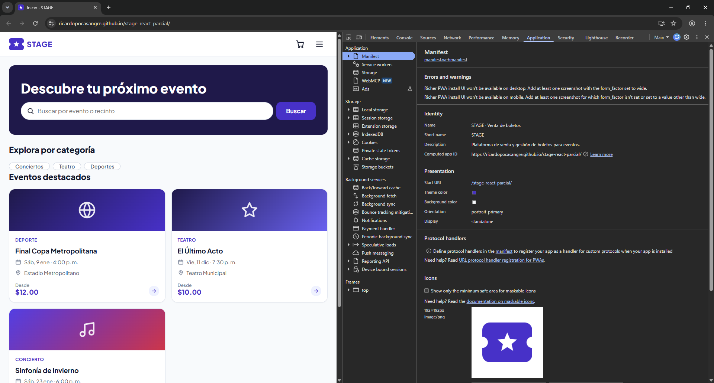
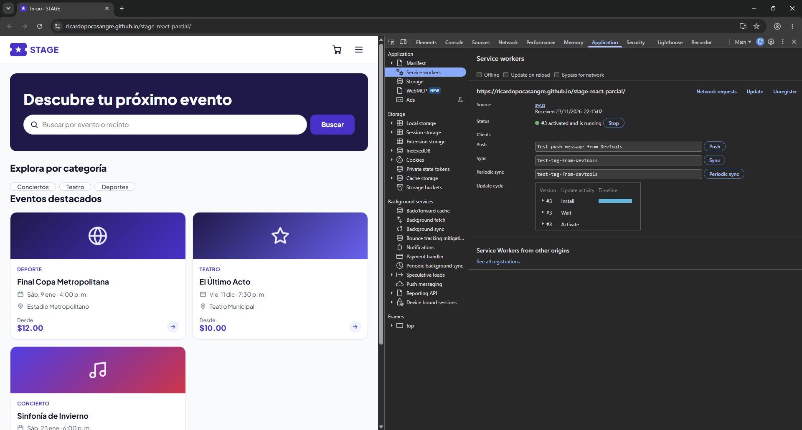
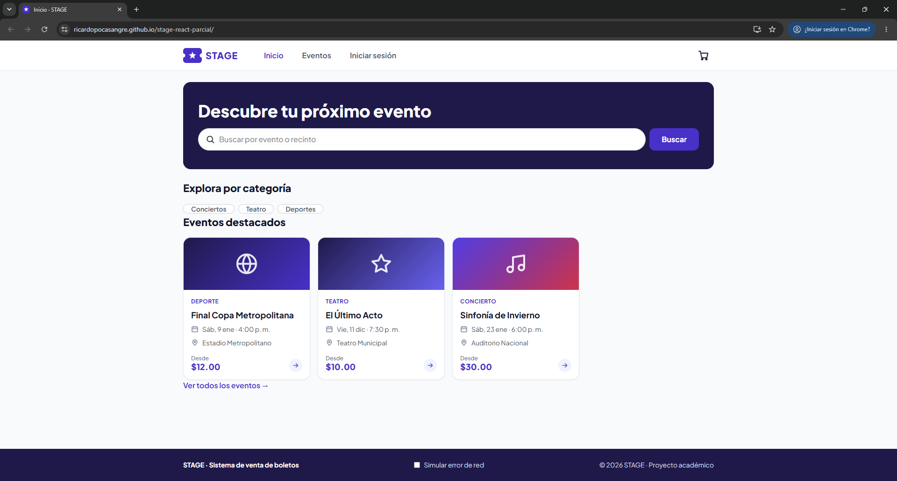

# STAGE · Plataforma de venta de boletos (entrega final)

PWA de **STAGE**, una plataforma de venta y gestión de boletos para eventos. Es la tercera entrega del proyecto: sobre la aplicación React de la segunda entrega se añadieron **React Router en modo datos**, estado global con **Context y `useReducer`**, una **API falsa** con capa de acceso a datos, **panel administrativo con CRUD y reportes**, **boletos con QR verificable**, **service worker con caché y modo offline** y publicación en **GitHub Pages**.

No hay backend, base de datos, pago real ni envío real de correos: la autenticación, los pagos y todas las mutaciones son **simulados** y se guardan en `localStorage`.

- **Aplicación publicada:** https://ricardopocasangre.github.io/stage-react-parcial/ (la publica el workflow de GitHub Actions al hacer push a `main`).
- **Documento de arquitectura y decisiones:** [`docs/arquitectura.md`](docs/arquitectura.md)

## Alcance

Se cubren los **ocho módulos** del MVP:

| Módulo | Qué incluye |
| --- | --- |
| 1. Usuarios y autenticación | Sesión simulada con roles cliente, organizador y administrador, registro, recuperación, perfil persistente y rutas protegidas |
| 2. Eventos | Listado con búsqueda y filtros en la URL, detalle, estados y CRUD administrativo |
| 3. Inventario y precios | Zonas, precios y disponibilidad; edición desde el panel |
| 4. Proceso de compra | Carrito global (Context + `useReducer`), flujo de cuatro pasos, resumen y persistencia |
| 5. Pagos | Pago simulado, estados de la orden y prevención del doble envío |
| 6. Boletos electrónicos | QR generado en el cliente, vista de boletos en `/boletos` y confirmación simulada por correo |
| 7. Panel de administración | Dashboard, eventos, inventario, usuarios y verificación de boletos |
| 8. Reportes | Reportes dinámicos por evento y periodo calculados a partir de las órdenes, con exportación CSV |

## Instalación y ejecución

Requiere Node.js 20 o superior.

```bash
npm install
npm run dev       # http://localhost:5173/stage-react-parcial/
npm run build     # genera dist/ (incluye 404.html y .nojekyll)
npm run preview   # sirve el build en http://localhost:4173/stage-react-parcial/
```

El service worker solo se registra en el build de producción: para probar la PWA y el modo offline usa `npm run build && npm run preview`.

## Cuentas de demostración y roles

Las contraseñas son ficticias, solo existen en este proyecto académico y se guardan con un hash simulado: no se almacenan contraseñas ni datos personales reales.

| Rol | Correo | Contraseña | Acceso |
| --- | --- | --- | --- |
| Cliente | cliente@stage.test | Cliente123 | Compra, `/boletos`, `/perfil` |
| Organizador | organizador@stage.test | Organizador123 | Lo anterior + `/admin`, `/admin/eventos`, `/admin/inventario` |
| Administrador | admin@stage.test | Admin123 | Todo, incluidos `/admin/reportes` y `/admin/usuarios` |

Para probar el pago, la tarjeta `4242 4242 4242 4242` se aprueba y una terminada en `0000` se rechaza. El interruptor **Simular error de red** del pie de página hace fallar la API para ver los estados de error.

## Mapa de rutas

| Ruta | Contenido | Acceso |
| --- | --- | --- |
| `/` | Inicio y destacados | Público |
| `/eventos` | Listado y búsqueda (`?q=&categoria=&orden=`) | Público |
| `/eventos/:id` | Detalle del evento | Público |
| `/carrito` | Carrito y resumen | Público |
| `/checkout` | Pago simulado y confirmación | Público (exige sesión para pagar) |
| `/login`, `/registro`, `/recuperar` | Autenticación (`/login?redirect=…`) | Público |
| `/boletos` | Boletos del usuario con QR | Autenticado |
| `/perfil` | Perfil | Autenticado |
| `/admin` | Dashboard | Administrador u organizador |
| `/admin/eventos` | CRUD de eventos | Administrador u organizador |
| `/admin/inventario` | Inventario y precios | Administrador u organizador |
| `/admin/reportes` | Reportes | Administrador |
| `/admin/usuarios` | Usuarios | Administrador |
| `*` | 404 | Público |

Las rutas se definen con `createBrowserRouter` y `RouterProvider` (`src/router.jsx`), con un layout compartido (`RootLayout`), `basename` tomado de `base` de Vite y `ProtectedRoute` para sesión y rol. Sin sesión se redirige a `/login?redirect=<ruta>`; con sesión pero sin el rol se muestra un 403. Las secciones del panel se cargan bajo demanda (`lazy`).

## Arquitectura de carpetas

```
.
├── .github/workflows/deploy.yml   # compila y publica dist/ en GitHub Pages
├── docs/                          # arquitectura y capturas
├── public/
│   ├── api/                       # API falsa: events.json, users.json, orders.json
│   ├── icons/                     # íconos de la PWA (192, 512, maskable)
│   └── img/                       # logotipo, favicon e íconos de la marca
├── scripts/postbuild.mjs          # crea dist/404.html y dist/.nojekyll
└── src/
    ├── api/        # http.js (fetch + AbortController), db.js (semilla + localStorage), index.js (API)
    ├── state/      # reducer.js, StoreProvider.jsx (Context + useReducer), session.js
    ├── components/ # Design System (Button, Field, Header, ProtectedRoute, PwaStatus…)
    ├── views/      # pantallas; views/admin/ con las secciones del panel
    ├── utils/      # formato, validación, carrito, boletos/QR, rutas de assets
    ├── data/       # constantes del dominio (categorías, íconos)
    ├── styles/     # tokens y una hoja por área
    ├── loaders.js  # loaders del router
    ├── router.jsx  # definición de rutas
    └── main.jsx
```

## Estado global

`StoreProvider` combina **Context y `useReducer`** y guarda en `localStorage`:

| Estado | Acciones | Clave |
| --- | --- | --- |
| Sesión (`user`) | `session/login`, `session/update`, `session/logout` | `stage.session.v3` |
| Carrito (`cart`) | `cart/add`, `cart/setQty`, `cart/remove`, `cart/clear` | `stage.cart.v3` |
| Preferencias (`prefs`) | `prefs/simulateError` | `stage.prefs.v3` |

Los componentes consumen el estado con `useSession()`, `useCart()` y `usePrefs()`, sin pasar props entre niveles. Los datos de negocio (eventos, órdenes, usuarios) no están en el Context: llegan del router y de la API.

## API falsa y mapeo de datos

`src/api` es una capa asíncrona separada de los componentes. Los JSON de `public/api/` son la **semilla** y las escrituras se persisten en `localStorage` (`stage.db.<colección>.v3`).

| Colección | Lectura | Escritura |
| --- | --- | --- |
| `events` | `api.events.list / get` | `create`, `update`, `remove`, `updateZone` (inventario y precios) |
| `users` | `api.users.list`, `login` | `register`, `updateProfile`, `changePassword`, `recover` |
| `orders` | `api.orders.list / listByUser` | `checkout` (cobro simulado, crea órdenes y descuenta inventario) |

- Todas las funciones aceptan un `signal` (`AbortController`). Los loaders usan el `request.signal` del router, así una navegación cancela la petición en curso; los formularios cancelan al desmontarse.
- Las lecturas leen el JSON con `fetch`, con latencia simulada; los errores se muestran con mensajes comprensibles y reintento. Hay estados de carga (barra de progreso y `HydrateFallback`), de error (`RouteError`) y vacío (`EmptyState`).
- Las órdenes semilla traen `daysAgo` y se convierten en fechas reales al leerlas, para que reportes y gráficos siempre tengan ventas recientes.

## Boletos y QR

Cada orden confirmada genera un boleto por unidad. El código tiene la forma `STG-<ORDEN>-<NN>-<CONTROL>` (`src/utils/tickets.js`), donde el código de control se deriva de la orden y del número de boleto. El QR se genera en el cliente con `qrcode.react` y codifica ese código. En `/admin` hay un verificador: comprueba el código de control y que la orden exista. La verificación es simulada, igual que el resto de la API.

## PWA y estrategias de caché

Configurada con `vite-plugin-pwa` (Workbox, `generateSW`) en `vite.config.js`:

- **Manifest:** nombre, descripción, `start_url`, `scope`, `display: standalone`, colores e íconos de 192×192, 512×512 y una variante **maskable**.
- **Precache del app shell:** HTML, JS, CSS e íconos de la PWA.
- **API (`/api/*.json`): `NetworkFirst`**, con la última respuesta como respaldo sin conexión (`stage-api`).
- **Imágenes: `CacheFirst`** (`stage-images`).
- **Fuentes:** `StaleWhileRevalidate` para la hoja de estilos y `CacheFirst` para los archivos de fuente.
- **`navigateFallback`:** `index.html`, para que cualquier ruta de la SPA cargue sin conexión.
- **Avisos:** `PwaStatus` informa cuando la app ya funciona sin conexión, cuando hay una **nueva versión** (con botón «Actualizar», `registerType: 'prompt'`) y cuando el navegador pierde la conexión. `InstallButton` muestra «Instalar app» cuando Chrome o Edge lo permiten.

**Cómo verificarlo:** `npm run build && npm run preview`, abrir DevTools → *Application* → *Manifest* y *Service Workers* (instalación verificable en Chrome o Edge), recorrer algunas pantallas con conexión y activar *Offline* en *Network*: el listado, los detalles ya visitados y el resto de la app siguen funcionando.

## Despliegue en GitHub Pages

1. En el repositorio: **Settings → Pages → Build and deployment → Source: GitHub Actions**.
2. Cada push a `main` ejecuta `.github/workflows/deploy.yml`: `npm ci`, `npm run build` y publicación de `dist/`.
3. `base` (`vite.config.js`) y `basename` (React Router) usan `/stage-react-parcial/`; `postbuild` copia `index.html` a **`404.html`** (las rutas profundas recargan la SPA) y crea **`.nojekyll`**.
4. Para publicar bajo otro nombre de repositorio: `VITE_BASE=/otro-nombre/ npm run build`.

## Responsive y accesibilidad

Móvil 375 px, tablet 768 px y escritorio 1440 px. HTML semántico, formularios etiquetados, navegación por teclado y foco visible, enlace para saltar al contenido, mensajes de error con `role="alert"`, estados `aria-current`, `aria-busy` y `aria-live`, texto alternativo en imágenes y en los QR, y respeto de `prefers-reduced-motion`. Al navegar, el foco pasa al contenido y se actualiza el título del documento. En móvil el panel se adapta con menú desplazable y tablas con desplazamiento controlado.

## Capturas

En [`docs/capturas`](docs/capturas): listado, detalle, carrito, checkout, confirmación con QR, boletos con QR, panel administrativo, CRUD de eventos, reportes, versiones en tablet y móvil, y modo offline.

Publicación y PWA, tomadas de la aplicación publicada en https://ricardopocasangre.github.io/stage-react-parcial/:

| Captura | Contenido |
| --- | --- |
|  | **Chrome DevTools → Application → Manifest:** nombre, colores, `start_url`, modo `standalone` e íconos del manifiesto. |
|  | **Chrome DevTools → Application → Service workers:** `sw.js` activado y en ejecución sobre el alcance `/stage-react-parcial/`. |
|  | **Sitio publicado** en GitHub Pages, abierto en Google Chrome. |

## Limitaciones

- Sin backend: la «base de datos» es `localStorage`, por lo que los datos no se comparten entre navegadores ni dispositivos y se pierden al borrar los datos del sitio.
- La autenticación, los roles, el pago y el correo son simulados: no ofrecen seguridad real (el hash de contraseñas es solo demostrativo).
- La verificación del QR comprueba el código y la orden local; un sistema real la haría contra un servidor.
- Sin conexión solo se puede navegar lo que ya se visitó una vez con conexión; el modo offline no sincroniza nada porque no hay servidor.
